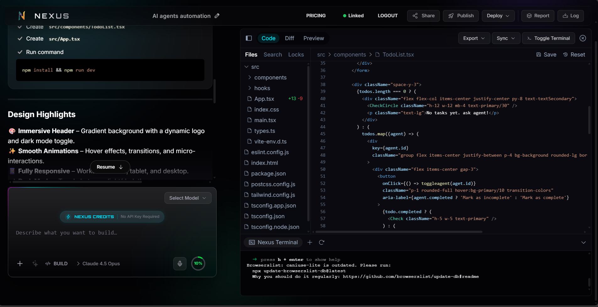

**Note:** this repo started as the page for our first product, a browser based AI app builder. We have since moved to **Nexus Desktop**. The old page is kept at the bottom as a record.

# Nexus

Nexus gives a company one shared brain for its AI, built to run its heaviest computer workflows. People and AI agents work together across the company's computers, and every job teaches the system how the company actually works, without retraining. So every new agent starts with years of company experience from day one.

Nexus Desktop is closed source. Public launch is December 2026.

## Launch film

https://github.com/user-attachments/assets/b41ee0d3-f381-4601-85d8-6db7afa38a97

Dramatized. Every feature shown is real.

## Voice agents in action

https://github.com/user-attachments/assets/2493365a-0c0b-44d6-92c2-e72493620d14

## What makes Nexus different

| | |
|---|---|
| **AI company brain** | Nexus doesn't start from zero. On day one it takes in the experience your company already has, past chats, meeting notes, files and your ChatGPT, Claude, Notion or Obsidian history. After that every job adds to it, what got corrected, what worked and what didn't, and it all carries over to any model with no retraining. It isn't a search box over your documents. It learns how the work actually gets done. |
| **Multiplayer AI** | Bots and people work on the same live job. Anyone on the team opens it from a link or QR code on their phone and can watch it, correct it or take over. |
| **Bot swarms across machines** | Bots on different PCs and different accounts work as one team. They message and @mention each other, split the job, share what they learn and ask the right person when a real decision comes up. |
| **Nexus hires other AIs** | Nexus can hand work to 12 agents already installed on your machine, Claude Code, Codex, Gemini CLI, Qwen Code, Aider, OpenCode, Goose, Amp, GitHub Copilot CLI, Cursor Agent, Kiro CLI and Ollama, and you can add your own. Nothing talks to a new agent until you say yes. |
| **Other AIs can hire Nexus** | It works the other way too. Coding agents like Claude Code can hand Nexus the desktop part of a job. |
| **Teach it by doing** | Do a task once while Nexus watches and listens, and it writes the skill itself. |
| **Any model, nothing lost** | Any lab's model, your own API key, Claude Code or Codex already signed in on your machine, or a local model with no internet. Memory and skills stay when you switch. |
| **Runs on your own PCs** | Works day and night on the Windows machines a company already owns. |
| **Fewer tokens, same answers** | Nexus never rewrites the earlier part of a conversation, so the model's prompt cache stays warm turn after turn. In one of our runs 68% of the next turn's input came straight from cache, and cached input is billed at a fraction of the normal price. Caching doesn't change what the model answers, so quality stays the same. Skills it has already learned also mean fewer steps on repeat work. |

## The office

Every AI worker in Nexus is run like a person on the team, which is what lets a company actually say yes to it.

| | |
|---|---|
| **Hire** | Give an AI worker a job title, a manager, skills and a monthly budget. It can be Nexus, a bot you built, or an agent you already use like Claude Code or Codex. |
| **Policies** | Each worker has a written policy for which tools, folders and hours it can use and how much it can spend in a day. Nexus checks the policy before a tool runs, so a "no" happens before anything is touched. |
| **Escalations** | When a worker is blocked or unsure it asks the right person, with everything it knows so far, instead of guessing. |
| **Review** | Finished work waits for a person to approve it. If it's rejected it goes back with the reason. |
| **Audit** | Every action and every dollar is in one log with a name next to it. |

## Privacy and security

| | |
|---|---|
| **Local-only mode** | One switch runs everything on your own machines with a local model. Every other connection is blocked and logged. |
| **Encrypted live links** | Share links and the phone remote are end to end encrypted with AES-256-GCM. The key lives only on the PC and the approved browser, so our relay can't read your work. |
| **Your rules on every action** | Budgets, approvals and one audit log over every agent, including Claude Code and Codex. Sends, spends and deletes wait for a person to say yes. |
| **No agent can promote itself** | No agent, and nobody watching a live job, can widen the agent's own permissions. |
| **Passwords stay hidden** | Saved logins are filled into sites without the model ever seeing the password. |

## Everything else it does

| | |
|---|---|
| **Gets better on its own** | When a hard task goes well Nexus turns it into a skill, fixes the skill the next time it trips, and can look back through old conversations when it needs something from weeks ago. Over time it learns how you like things done. |
| **Reach it from anywhere** | The desktop app, a terminal, or the chat apps your team already uses, Telegram, WhatsApp, Slack, Discord, Signal and more. Send a voice note and it gets transcribed, and you can start a conversation in one app and pick it up in another. |
| **Built for the terminal too** | A full terminal app with multiline input, slash commands, history, and the option to stop and redirect Nexus halfway through a task. |
| **Jobs on a schedule** | Tell it in plain words, a report every morning or a check every Friday, and it runs on its own and sends the result wherever you want. |
| **Splits big jobs up** | Big work gets split across helper agents that run side by side, each with its own model and limits. |

## Contact

Yash Hambarde, founder. yash@nexusbuild.in

---

## Our first product (January 2026)

A browser based IDE where you describe an app and AI builds and deploys it, with no install or setup. It worked with 19+ AI providers and you could switch models mid conversation.

